# Financial Risk Management: ML Pipeline with Visual Gallery

A single Jupyter notebook that takes the IBM *Financial Risk Management using Machine Learning on z/OS* pattern and extends it into a full mini-project: data engineering, ML models, MLOps (registry + drift), computer vision, a Flask scoring service, Bash / C++ / Go clients, and a large gallery of 2D and 3D visuals.

The four model inputs are `age`, `income`, `numberOfCard` and `numberOfCarLoan`; the output is a repayment score between 0 and 1.

> **Note:** all data in the notebook is **synthetic**. Numbers are for learning and illustration only, not real financial advice.

## Interactive 3D

Open [`interactive_3d.html`](interactive_3d.html) in a browser (needs internet to load plotly.js): rotatable score surface with loan/card selectors, 3D scatter, 3D bars, 3D histogram and a model-comparison 3D chart.

## Project files (flat, no sub-folders)

| File | What it is |
|---|---|
| `financial_risk_management.ipynb` | main notebook (run top to bottom) |
| `interactive_3d.html` | interactive Plotly 3D gallery |
| `app.py` | Flask scoring service (`/health`, `/score`) |
| `call_score.sh` | Bash client |
| `score.cpp` | C++ scoring engine (logistic coefficients) |
| `main.go` | Go concurrent client |
| `loan_score_lr_v1_model.joblib`, `loan_score_lr_v1_metadata.json` | registered model and metadata |
| `customers_features.csv` | validated + engineered features |
| `*.png` | all figures shown below |

## Quick start

```bash
pip install numpy pandas scikit-learn matplotlib opencv-python flask joblib requests
# optional extra models: pip install xgboost tensorflow
jupyter notebook financial_risk_management.ipynb
```

## Diagrams

### 3D system diagram

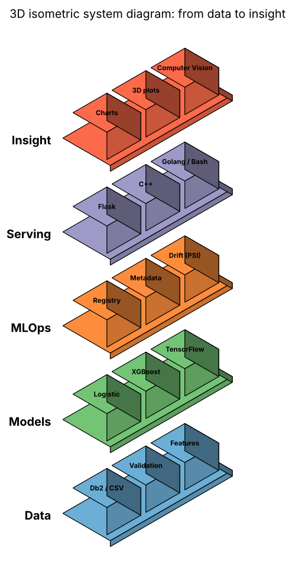

### Comparison tables

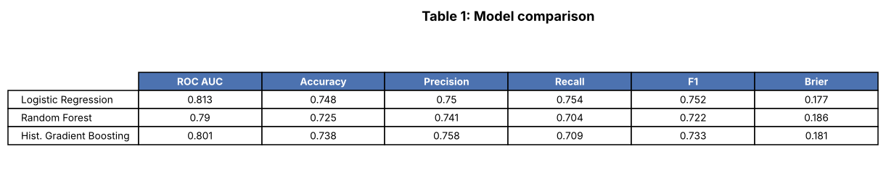

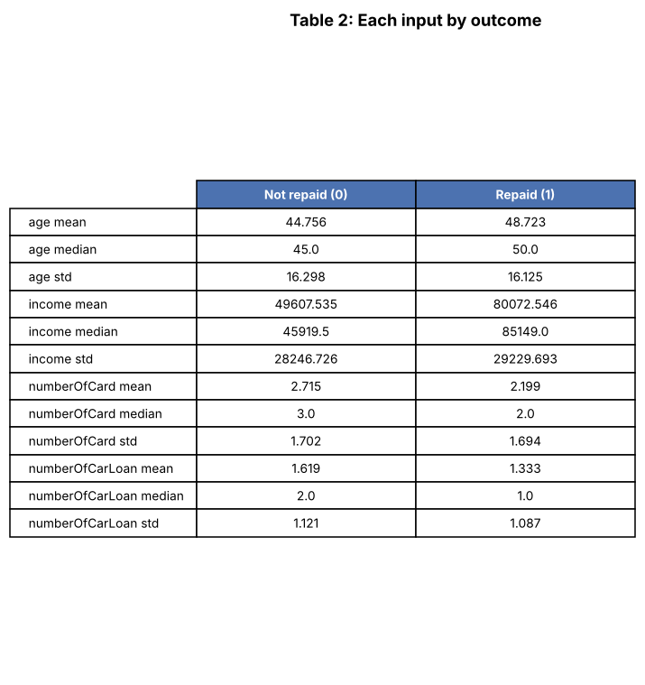

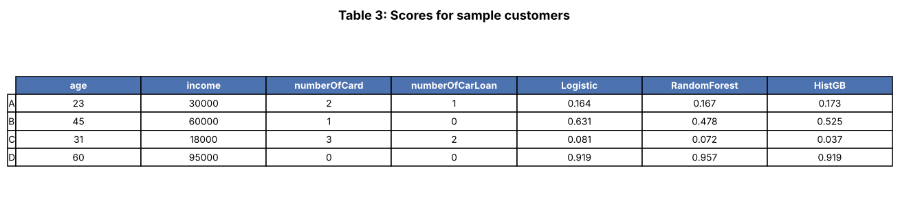

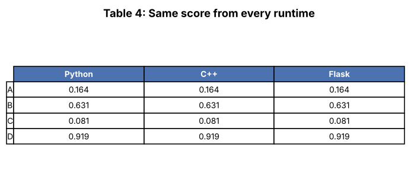

### Charts for each input

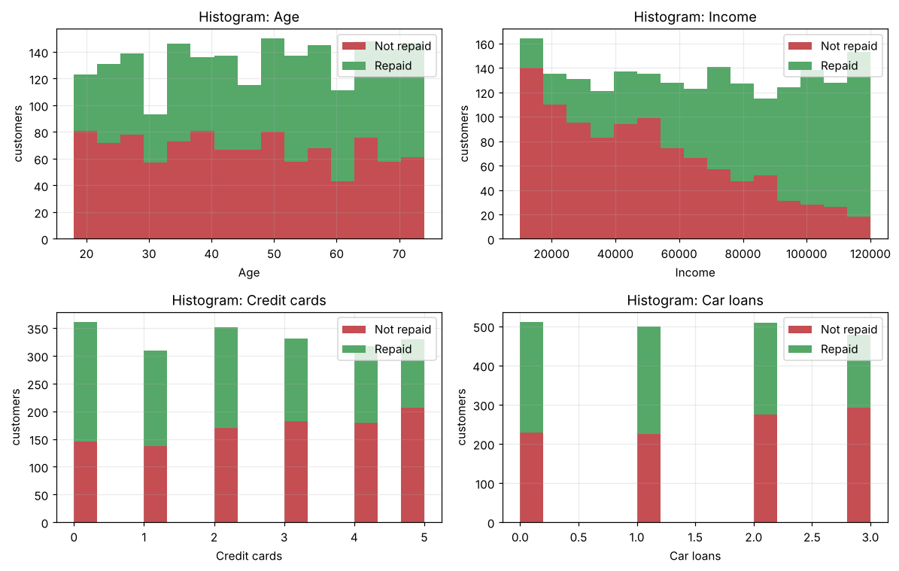

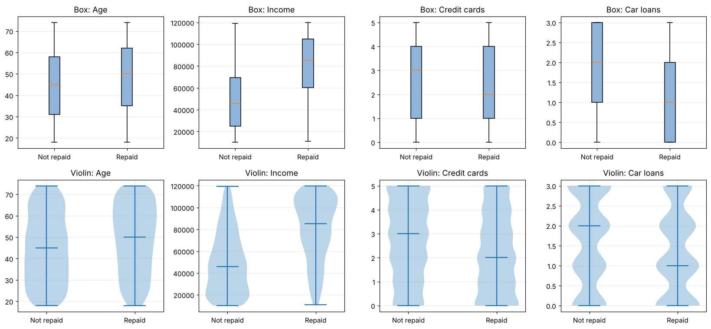

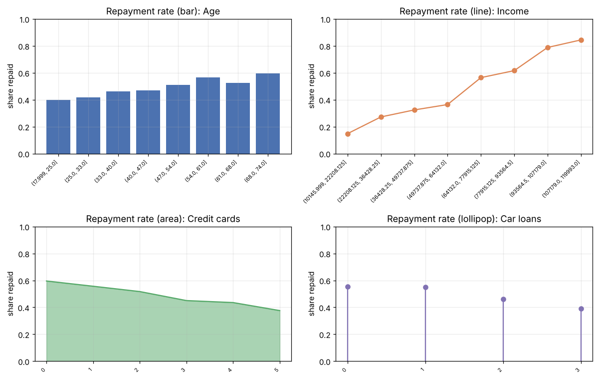

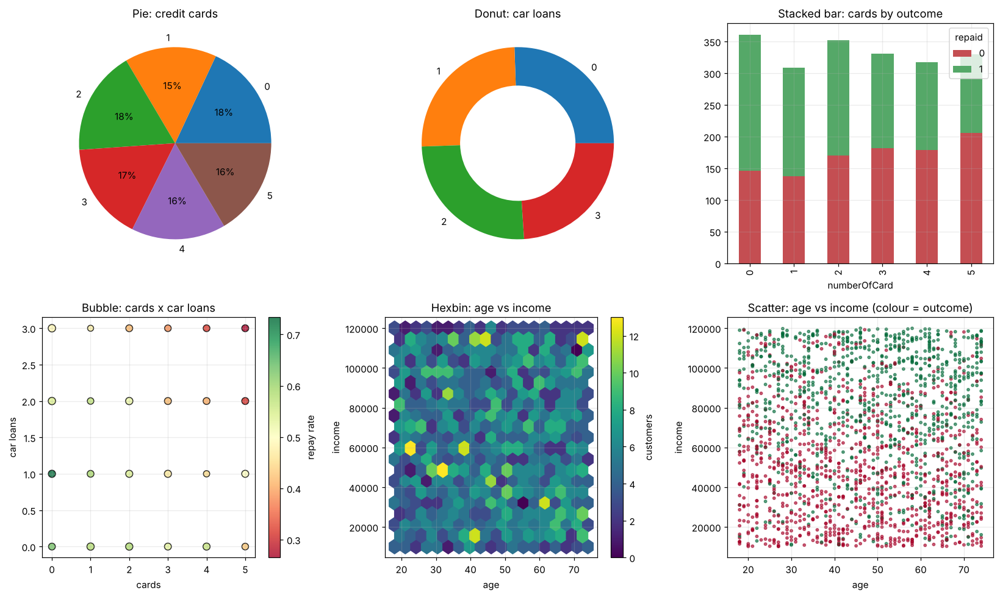

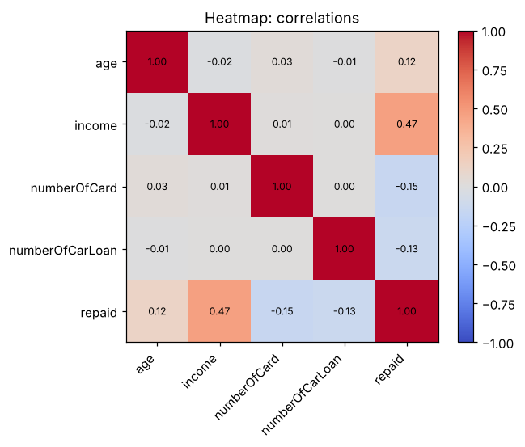

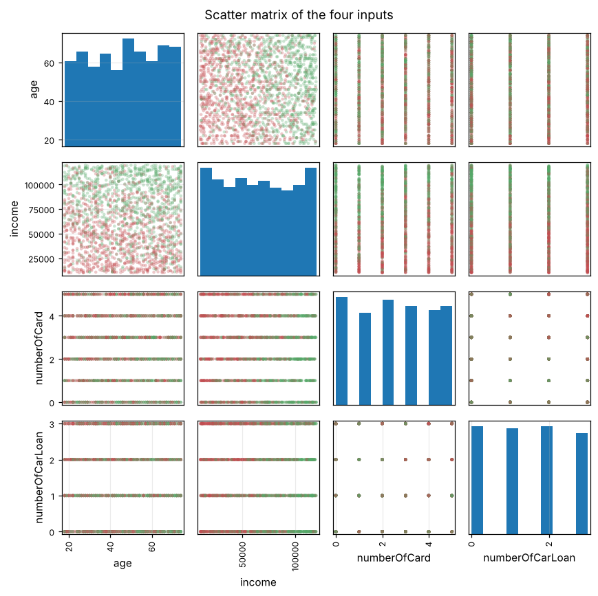

### Charts for each model

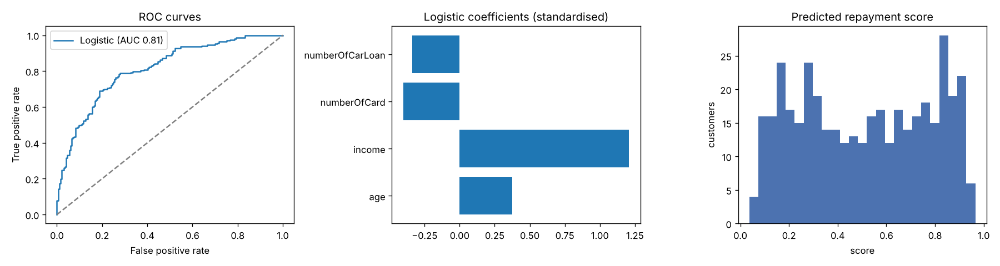

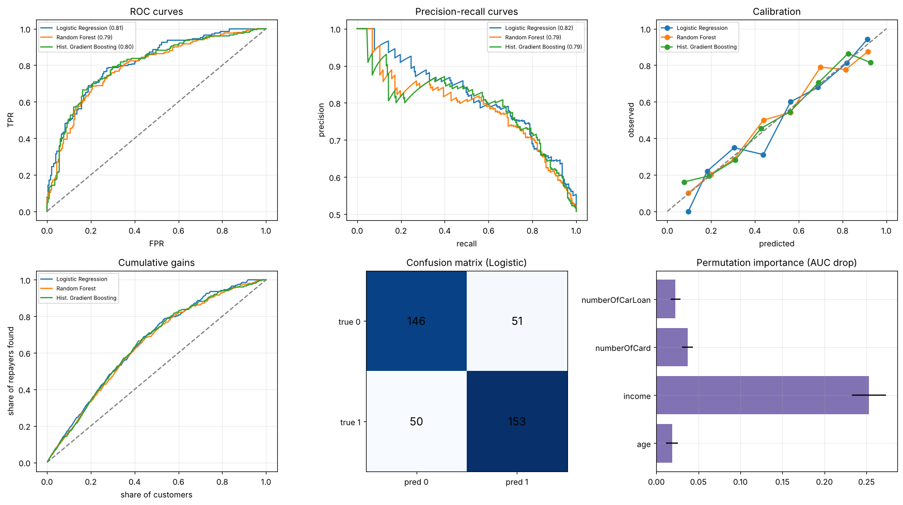

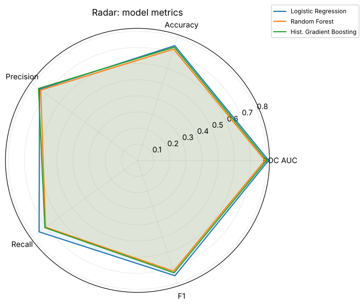

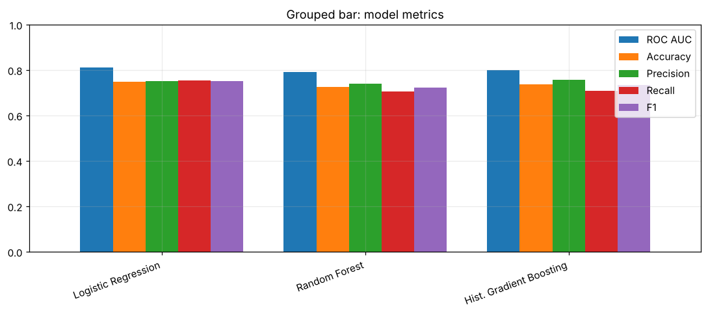

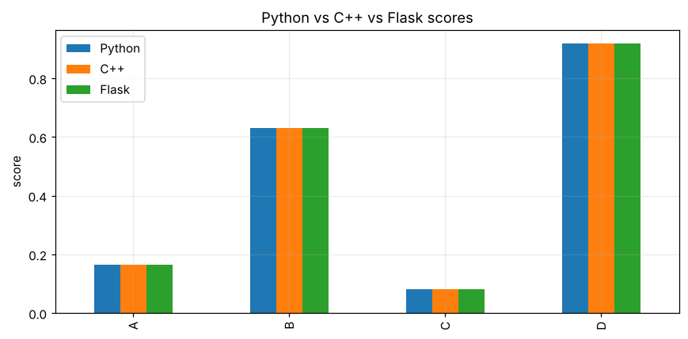

### 3D graphs and 3D charts

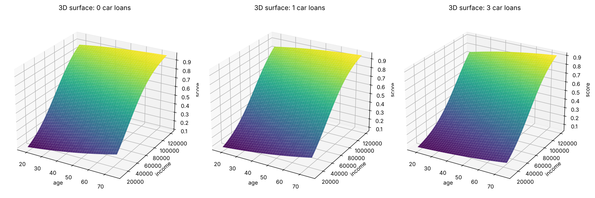

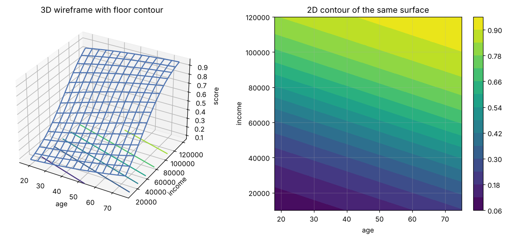

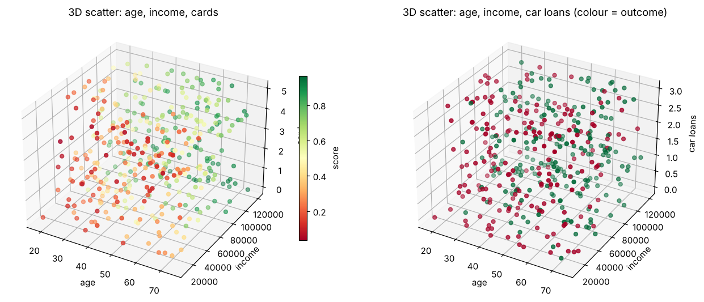

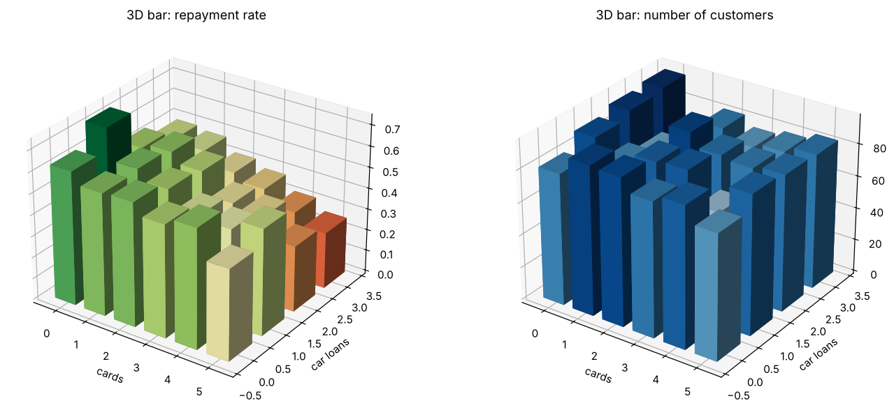

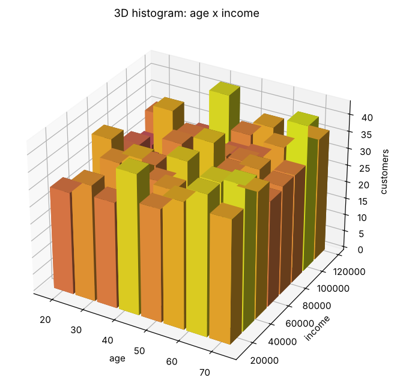

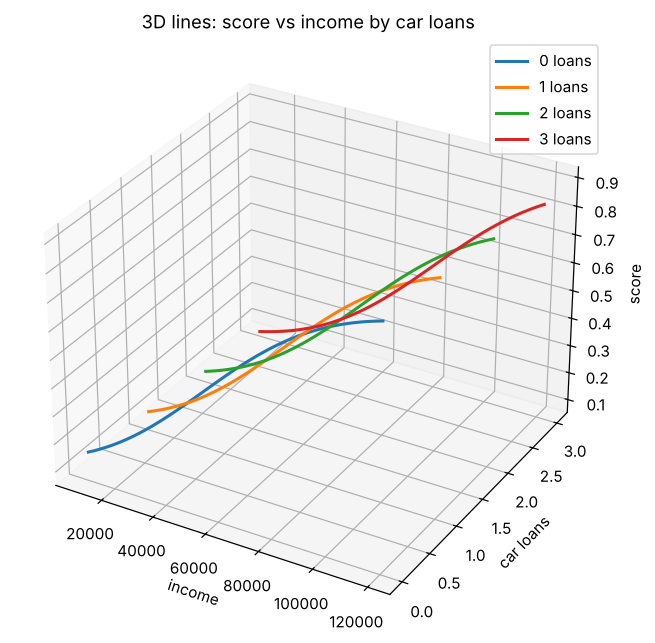

## Credentials

Never put your IBM client ID or secret in the notebook. Set `IBM_CLIENT_ID` and `IBM_CLIENT_SECRET` as environment variables before running Part A.

## License

Apache License 2.0 (follows the original IBM code pattern).
